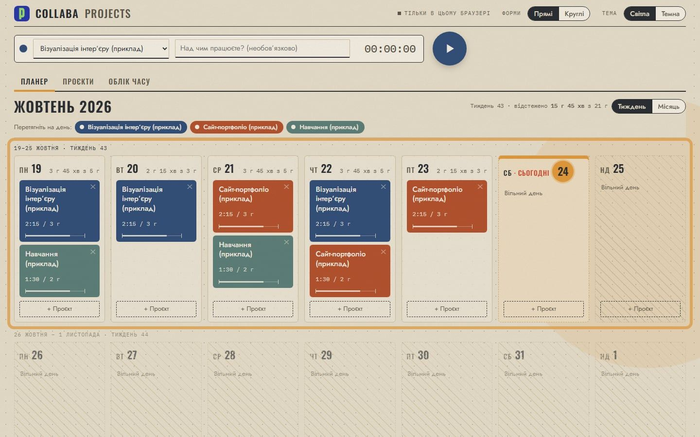
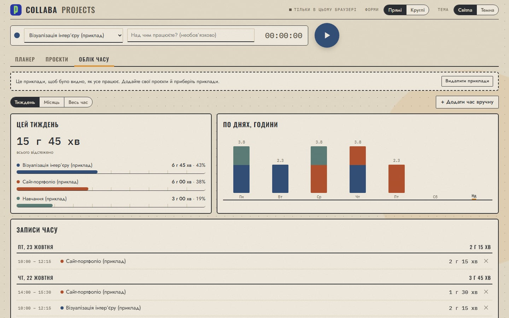
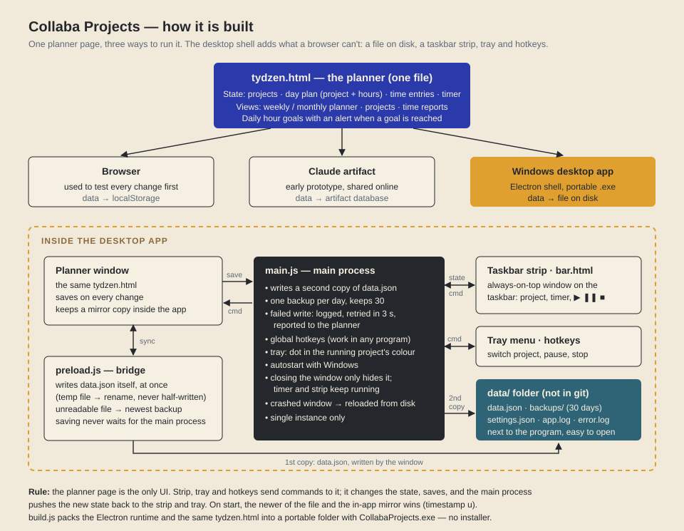

# Collaba Projects

A small Windows time tracker and weekly planner for my architecture and visualization studio. I needed one place to plan the week by project, run a timer without switching windows, and see where the hours went. The app does that, and nothing else.

Designed by Maksym Lysogora (product idea, UX, visual style, testing). Built with AI-assisted development (Claude Code).



## What it does

- **Planner:** weeks scroll top to bottom; drag a project onto a day and set planned hours. Monthly view too.
- **Timer:** start, pause and stop from the planner, from a strip on the Windows taskbar, from the tray menu or with global hotkeys that work in any program.
- **Time report:** totals for the week, month or all time, hours per day by project, and the full list of time entries. Time can also be added by hand.
- **Day goals:** an alert when the planned hours for a project are reached.
- Light "kraft paper" theme and a dark graphite theme. Interface in Ukrainian.



## How it is built



- `tydzen.html` is the whole planner in one file. It runs in a browser (data in localStorage), which is how every change is tested first, and inside the desktop app.
- `desktop/` is the Electron shell. It adds what a browser can't: a data file on disk, the taskbar strip (`bar.html`), the tray icon, global hotkeys and autostart.
- Saving is built to never lose data: the window writes `data.json` itself on every change (temp file, then rename), the main process writes a second copy and one backup per day (kept for 30 days), and a failed write is logged and retried.
- `desktop/build.js` packs the Electron runtime and the same `tydzen.html` into a portable folder with `CollabaProjects.exe`. No installer.

## Run it

```bash
cd desktop
npm install
npm start          # run from source
npm run build      # portable app in ../dist/CollabaProjects-win32-x64
```

Or just open `tydzen.html` in a browser to try the planner with demo data.

Data is kept in `data/` next to the program and is not part of this repository. Changes are listed in [PATCHNOTES.md](PATCHNOTES.md) (in Ukrainian).
