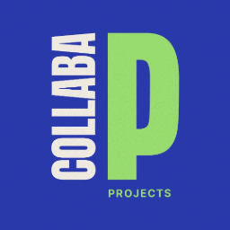
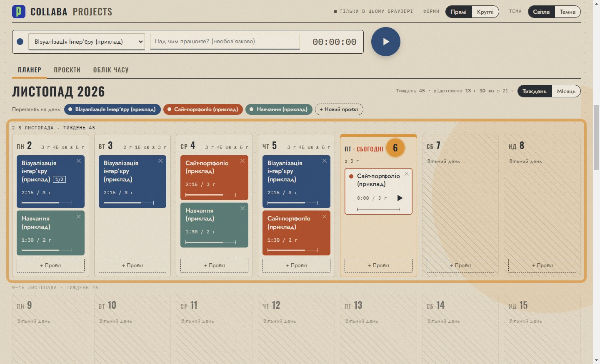
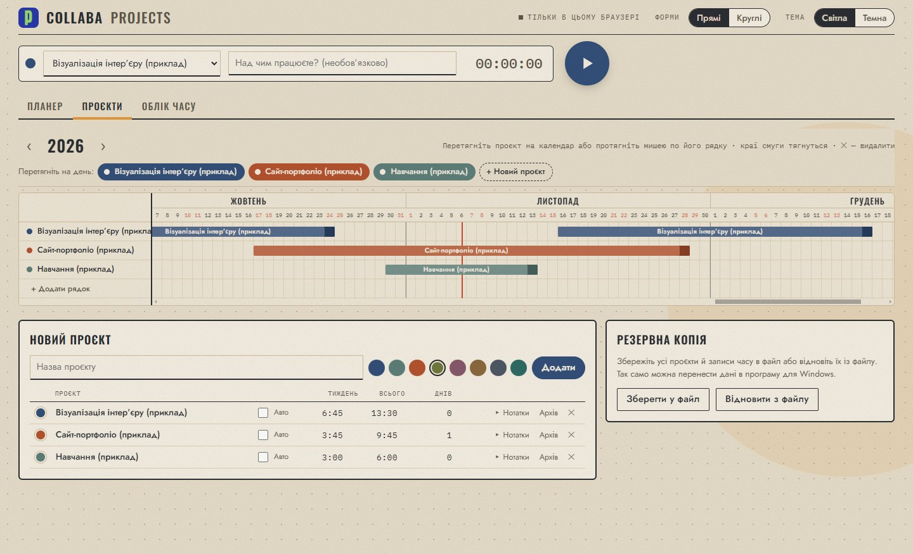
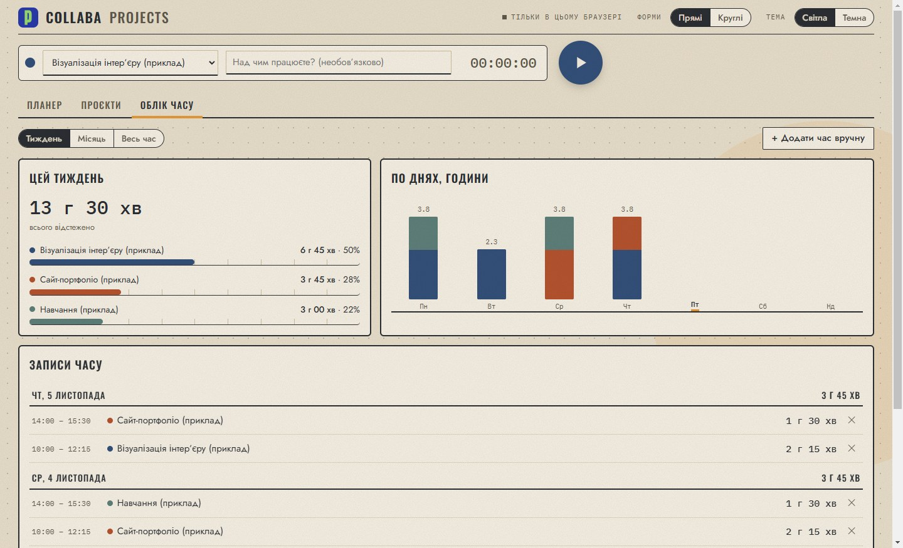
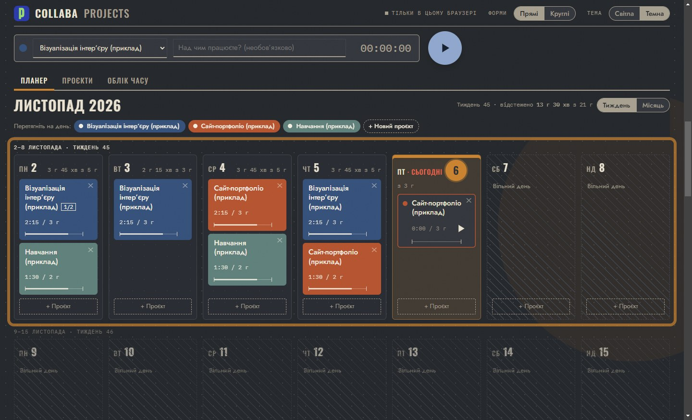
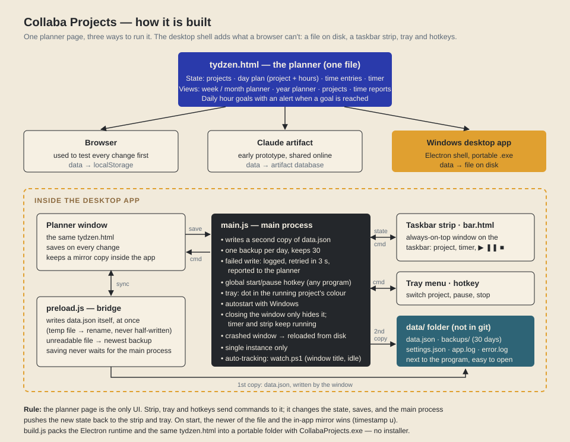

<p align="center"></p>

<h1 align="center">Collaba Projects</h1>

<p align="center">A small Windows time tracker and project planner, styled like a drafting desk.<br>Plan the year and the week, run a timer without switching windows, and see where the hours went.</p>

<p align="center"><a href="#run-it"><b>Run it</b></a> · <a href="#українською">Українською</a></p>



I built it for my own architecture and visualization studio, because I wanted one place to plan work by project and track time without a subscription or an account. Your data stays in a plain JSON file on your computer. Nothing is sent anywhere.

Designed by Maksym Lysogora (product idea, UX, visual style, testing). Built with AI-assisted development (Claude Code). The interface is in Ukrainian.

## What it does

- **Week and month planner.** Weeks scroll top to bottom and snap into a fixed frame. Drag a project onto a day and set planned hours. Click a card to unfold it: edit the time spent, change the goal, keep a checklist for that day.
- **Timer everywhere.** Start, pause and stop from the planner, from a slim strip on the Windows taskbar, from the tray menu or with one global hotkey (`Ctrl+Alt+Shift+P`) that works in any program.
- **Automatic tracking (opt-in, per project).** Tick "Авто" and give a keyword, such as a project code in your file names. The timer starts when that word stays in the active window's title for 20 seconds and stops a minute after it goes away. It reads window titles only and takes no screenshots.
- **Honest time.** Any running timer pauses after 5 minutes without mouse or keyboard input, and those minutes are not counted. It also pauses while a fullscreen game or app is in front, and resumes when you return.
- **Year planner.** All twelve months in one horizontal strip. Drag a project tag onto the calendar, stretch the bar from start to deadline, keep several phases in one row.
- **Time reports.** Totals for the week, month or all time, hours per day by project and the full list of entries. Forgotten work can be added by hand.
- **Day goals.** An alert when the planned hours for a project are reached, with one click to switch to the next one.
- **Light and dark themes**, with a palette of 20 muted printer's inks for projects.







## Run it

You need Windows and [Node.js](https://nodejs.org/).

```bash
cd desktop
npm install
npm start          # run from source
npm run build      # portable app in ../dist/CollabaProjects-win32-x64
```

The build is a folder with `CollabaProjects.exe`; there is no installer. To try only the planner, open `tydzen.html` in a browser. It starts with demo data and keeps everything in that browser. The taskbar strip, hotkey and automatic tracking need the desktop app.

Closing the window only hides it, so the timer keeps running. To quit, use the icon next to the clock. "Запускати з Windows" in the header turns on autostart; it is off by default.

**Your data** is in the `data/` folder of this repository, which git ignores: `data.json` plus one backup per day, kept for 30 days. If you move the built program somewhere else, it uses `%APPDATA%\CollabaProjects` instead. Rebuilding does not touch your data.

## How it is built



- `tydzen.html` is the whole planner in one file, with no framework and no build step. The same file runs in a browser, which is how every change is tested first, and inside the desktop app.
- `desktop/` is the Electron shell. It adds what a browser can't: a data file on disk, the taskbar strip (`bar.html`), the tray icon, the global hotkey, autostart and the activity watcher (`watch.ps1`).
- **Saving is built not to lose data.** The window writes `data.json` itself on every change (temp file, then rename), the main process writes a second copy and a daily backup, and a failed write is logged and retried.
- `desktop/build.js` packs the Electron runtime and the same `tydzen.html` into a portable folder.

Changes are listed in [PATCHNOTES.md](PATCHNOTES.md) (in Ukrainian).

## Українською

Невеликий трекер часу й планувальник проєктів для Windows: планер на тиждень і місяць, річний календар із дедлайнами, таймер на панелі задач, автоматичне відстеження за назвою активного вікна, звіти по годинах. Без акаунта й підписки: дані лежать у звичайному файлі на вашому комп'ютері й нікуди не надсилаються.

Щоб запустити, потрібні Windows і Node.js: команди наведено в розділі [Run it](#run-it).

## License

The code is under the [MIT License](LICENSE). The Collaba name and logo are not covered by it: if you publish your own fork, please use your own.
